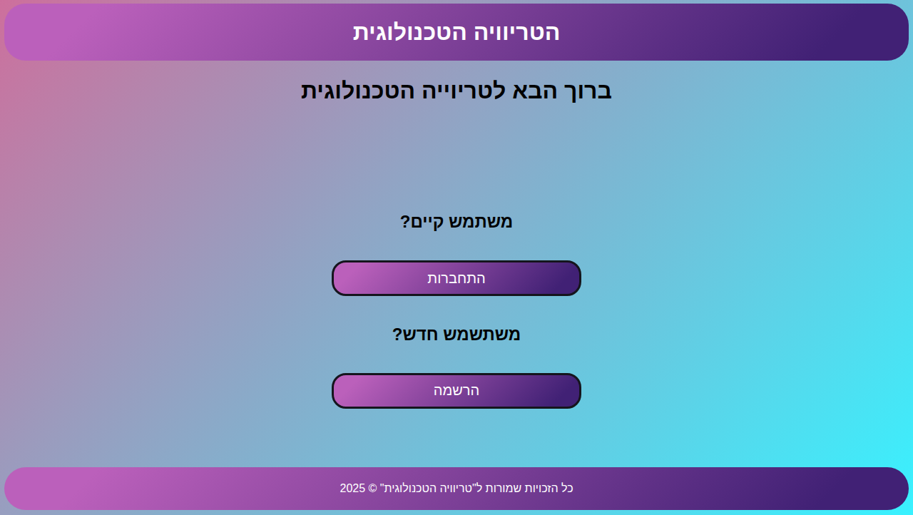
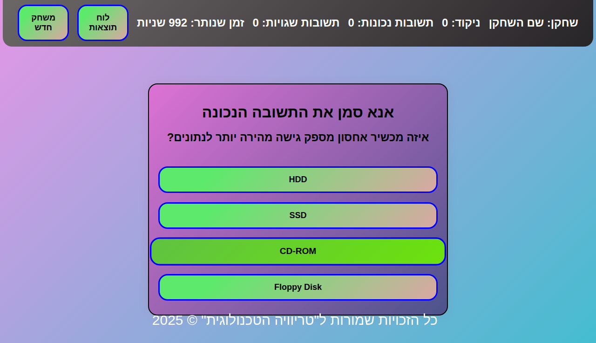
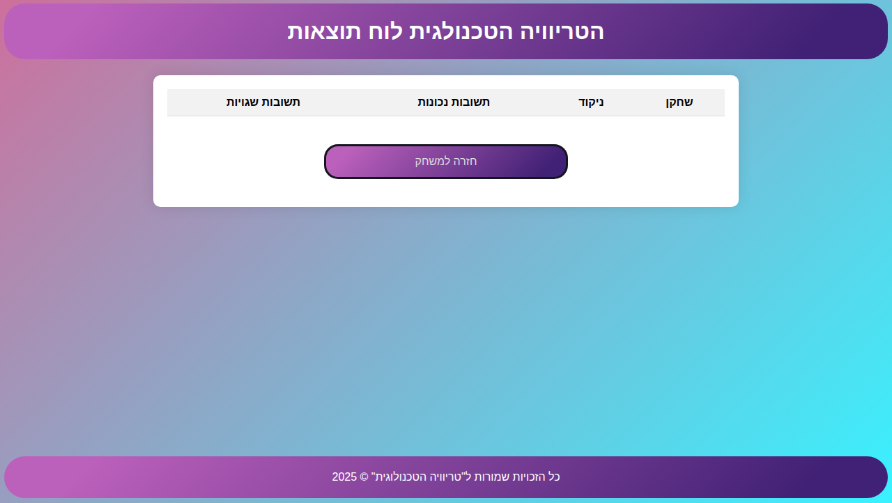

<div align="center">

# 🎮 TechTrivia - טריוויה טכנולוגית

[](https://avigdor96.github.io/TechTrivia/)
[](https://developer.mozilla.org/en-US/docs/Web/HTML)
[](https://developer.mozilla.org/en-US/docs/Web/CSS)
[](https://developer.mozilla.org/en-US/docs/Web/JavaScript)
[](https://opensource.org/licenses/MIT)

**משחק טריוויה אינטראקטיבי מתקדם עם שאלות טכנולוגיות מאתגרות**

*האתגר הטכנולוגי המושלם לבדיקת הידע שלך!*

</div>

---

## 📖 רקע כללי

**TechTrivia** נוצר מתוך רצון לשלב בין למידה למוטיבציה באמצעות גיימיפיקציה. המשחק מציע חוויה אינטראקטיבית ומהנה לבדיקת ידע טכנולוגי, עם דגש על עיצוב מודרני, ביצועים גבוהים ונגישות מקסימלית.

המשחק פותח כפרויקט לימודי ומתאים לכל רמת ידע - מתחילים המכירים עקרונות בסיסיים ועד מתקדמים הבקיאים בטכנולוגיות העדכניות ביותר.

### 🎯 יעדי הפרויקט
- **חינוכי**: העמקת הידע הטכנולוגי באופן אינטראקטיבי
- **טכני**: הדגמת יכולות פיתוח web מתקדמות
- **חברתי**: יצירת פלטפורמה לתחרות ידידותית

---

## 📸 תצוגות המשחק

### 🔐 מסך התחברות


*מסך התחברות האלגנטי עם אופציות הרשמה והתחברות*

### 🎲 מסך המשחק


*ממשק המשחק הראשי עם טיימר, ניקוד והצגת שאלות*

### 🏆 לוח התוצאות


*לוח התוצאות המציג את השיאים של כל השחקנים*

> **💡 טיפ**: לקבלת תמונות מסך עדכניות, השתמש בכלים כמו:
> - **Windows**: `Win + Shift + S` או כלי החיתוך
> - **Mac**: `Cmd + Shift + 4` 
> - **Linux**: `gnome-screenshot` או `flameshot`
> - **דפדפן**: F12 > Device Toolbar לסימולציה של מכשירים שונים

---

## ✨ תכונות המשחק

<table>
  <tr>
    <th>🎯 תכונה</th>
    <th>📝 תיאור</th>
    <th>🔧 סטטוס</th>
  </tr>
  <tr>
    <td>🎨 <strong>ממשק אינטואיטיבי</strong></td>
    <td>עיצוב רספונסיבי ונגיש עם אנימציות חלקות</td>
    <td>✅ פעיל</td>
  </tr>
  <tr>
    <td>⏱️ <strong>מערכת טיימר</strong></td>
    <td>ספירה לאחור דינמית עם התראות ויזואליות</td>
    <td>✅ פעיל</td>
  </tr>
  <tr>
    <td>💾 <strong>שמירה מקומית</strong></td>
    <td>localStorage לשמירת התקדמות ונתוני משתמשים</td>
    <td>✅ פעיל</td>
  </tr>
  <tr>
    <td>🏆 <strong>לוח שיאים</strong></td>
    <td>מעקב אחר הישגים ותחרותיות בין שחקנים</td>
    <td>✅ פעיל</td>
  </tr>
  <tr>
    <td>📊 <strong>מאגר שאלות</strong></td>
    <td>+50 שאלות בקטגוריות טכנולוגיות מגוונות</td>
    <td>✅ פעיל</td>
  </tr>
  <tr>
    <td>🔄 <strong>שאלות אקראיות</strong></td>
    <td>אלגוריתם לבחירת שאלות ללא חזרות</td>
    <td>✅ פעיל</td>
  </tr>
  <tr>
    <td>📱 <strong>עיצוב רספונסיבי</strong></td>
    <td>תמיכה במחשב, טאבלט וסמארטפון</td>
    <td>✅ פעיל</td>
  </tr>
  <tr>
    <td>🌐 <strong>רב-לשוני</strong></td>
    <td>ממשק בעברית עם תמיכה בטקסט דו-כיווני</td>
    <td>✅ פעיל</td>
  </tr>
  <tr>
    <td>🔊 <strong>משוב אודיו</strong></td>
    <td>צלילי הצלחה וכישלון (תכונה עתידית)</td>
    <td>🚧 בפיתוח</td>
  </tr>
  <tr>
    <td>📈 <strong>סטטיסטיקות</strong></td>
    <td>מעקב מפורט אחר ביצועים (תכונה עתידית)</td>
    <td>🚧 בפיתוח</td>
  </tr>
</table>

---

## 🛠️ טכנולוגיות ופיתוח

### 🏗️ מבנה טכנולוגי

<div align="center">

| 🔧 שכבה | 💻 טכנולוגיה | 📝 תיאור |
|:---:|:---:|:---|
| **🎨 Frontend** | HTML5 | מבנה סמנטי מתקדם עם accessibility |
| **🎭 Styling** | CSS3 | Grid, Flexbox, משתנים CSS ואנימציות |
| **⚡ Logic** | Vanilla JavaScript | ES6+, אסינכרוניות ו-API מודרניים |
| **💾 Storage** | localStorage API | שמירה מקומית של נתוני משתמש |
| **🎪 UI/UX** | SweetAlert2 | חלונות דיאלוג אינטראקטיביים |
| **🎊 Effects** | Canvas Confetti | אפקטים ויזואליים לחגיגות |

</div>

### 📂 מבנה הפרויקט

```
TechTrivia/
├── 📄 logIn.html              # דף התחברות ראשי
├── 🎮 memoryGame.html         # ממשק המשחק
├── 🏆 scoreboard.html         # לוח התוצאות
├── 📁 css/
│   ├── 🎨 logIn.css          # עיצוב דף התחברות
│   ├── 🎯 memoryGame.css     # עיצוב מסך המשחק
│   ├── 📊 scoreboard.css     # עיצוב לוח התוצאות
│   └── 🖼️ headerFooter.css   # עיצוב כותרת וכותרת תחתונה
├── 📁 js/
│   ├── 🔐 logIn.js           # לוגיקת התחברות ומשתמשים
│   ├── 🧠 memoryGame.js      # מנוע המשחק ושאלות
│   └── 🏅 scoreboard.js      # ניהול לוח התוצאות
├── 📁 screenshots/           # תמונות מסך למסמכים
├── 📁 examples/              # דוגמאות קוד ותבניות
│   ├── 📋 questions.json     # דוגמה למבנה שאלות JSON
│   ├── 🎨 advanced-style.css # דוגמאות עיצוב מתקדמות
│   └── ⚡ game-examples.js   # דוגמאות קוד JavaScript
└── 📖 README.md              # המדריך שלפניכם
```

---

## 🚀 התקנה והפעלה

### ⚡ הפעלה מהירה

```bash
# 1️⃣ שכפול המאגר
git clone https://github.com/Avigdor96/TechTrivia.git

# 2️⃣ מעבר לתיקיית הפרויקט
cd TechTrivia

# 3️⃣ פתיחה בדפדפן (בחר אחת מהאפשרויות)
# אופציה א': פתיחה ישירה
open logIn.html  # Mac
start logIn.html # Windows
xdg-open logIn.html # Linux

# אופציה ב': הפעלת שרת מקומי (מומלץ)
python -m http.server 8080  # Python 3
# או
python -m SimpleHTTPServer 8080  # Python 2
# או
npx serve .  # אם יש Node.js

# 4️⃣ גישה דרך הדפדפן
# http://localhost:8080/logIn.html
```

### 🌐 פריסה ב-GitHub Pages

לפרסום המשחק באופן חינמי:

1. **Fork** את המאגר לחשבון שלך
2. עבור ל-**Settings** > **Pages**
3. תחת **Source** בחר **Deploy from a branch**
4. בחר **Branch: main** ו-**/ (root)**
5. לחץ **Save**
6. המשחק יהיה זמין ב: `https://[username].github.io/TechTrivia`

---

## 🎯 מדריך שימוש

### 🕹️ התחלת משחק

1. **📝 הרשמה/התחברות**: צור חשבון חדש או התחבר עם חשבון קיים
2. **🎲 התחלת המשחק**: לחץ על "התחל משחק" מהמסך הראשי
3. **⏰ מענה על שאלות**: יש לך 1000 שניות לענות על כמה שיותר שאלות
4. **🏆 צפייה בתוצאות**: בסיום המשחק תוכל לראות את הניקוד ולהשוות עם שחקנים אחרים

### 🎮 טיפים למשחק מיטבי

- **⚡ זמן**: השתמש בזמן בחוכמה - שאלות קלות כדאי לענות עליהן מהר
- **🎯 דיוק**: עדיף תשובה נכונה אחת מאשר מספר תשובות שגויות
- **📚 למידה**: שים לב להסברים שמופיעים לאחר כל תשובה
- **🔄 חזרה**: שחק מספר פעמים כדי לשפר את הביצועים

---

## 💻 דוגמאות קוד

### 🗃️ טעינת שאלות מקובץ JSON

צפו בדוגמה המלאה בקובץ [`examples/questions.json`](examples/questions.json):

```json
{
  "categories": {
    "programming": {
      "name": "תכנות",
      "description": "שאלות על שפות תכנות ופיתוח"
    }
  },
  "questions": [
    {
      "id": 1,
      "category": "programming",
      "difficulty": "medium",
      "question": "מה משמעות ראשי התיבות HTML?",
      "answers": [
        "Hyper Text Markup Language",
        "High Tech Machine Learning",
        "Hyper Transfer Main Logic",
        "Hyper Tool Multi Language"
      ],
      "correct": "Hyper Text Markup Language",
      "explanation": "HTML היא שפת סימון המשמשת ליצירת דפי אינטרנט",
      "points": 15
    }
  ]
}
```

**שילוב שאלות JSON במשחק:**

```javascript
// טעינת שאלות מקובץ JSON
async function loadQuestions() {
    try {
        const response = await fetch('./examples/questions.json');
        const data = await response.json();
        
        // החלפת מערך השאלות הקיים
        questions = data.questions;
        
        console.log(`נטענו ${questions.length} שאלות בהצלחה`);
    } catch (error) {
        console.error('שגיאה בטעינת השאלות:', error);
        // השתמשו בשאלות ברירת המחדל
    }
}

// קריאה לפונקציה בתחילת המשחק
loadQuestions().then(() => {
    startGame();
});
```

### ⏱️ מערכת טיימר מתקדמת

```javascript
class GameTimer {
    constructor(initialTime = 30) {
        this.time = initialTime;
        this.interval = null;
        this.callbacks = {
            onTick: null,
            onTimeout: null,
            onWarning: null
        };
    }

    start() {
        this.interval = setInterval(() => {
            this.time--;
            
            // עדכון תצוגה
            this.updateDisplay();
            
            // אזהרה ב-10 שניות אחרונות
            if (this.time === 10 && this.callbacks.onWarning) {
                this.callbacks.onWarning();
            }
            
            // סיום הזמן
            if (this.time <= 0) {
                this.stop();
                if (this.callbacks.onTimeout) {
                    this.callbacks.onTimeout();
                }
            }
        }, 1000);
    }

    stop() {
        if (this.interval) {
            clearInterval(this.interval);
            this.interval = null;
        }
    }

    updateDisplay() {
        const timerElement = document.getElementById('timer');
        if (timerElement) {
            timerElement.textContent = this.time;
            
            // שינוי צבע ברגעים האחרונים
            if (this.time <= 10) {
                timerElement.classList.add('warning');
            }
        }
    }
}

// שימוש בטיימר
const gameTimer = new GameTimer(60);
gameTimer.callbacks.onTimeout = () => {
    alert('הזמן נגמר!');
    endGame();
};
gameTimer.start();
```

### 💾 ניהול localStorage מתקדם

```javascript
class GameStorage {
    constructor() {
        this.keys = {
            USERS: 'techTrivia_users',
            CURRENT_USER: 'techTrivia_currentUser',
            HIGH_SCORES: 'techTrivia_highScores'
        };
    }

    // שמירת נתוני משתמש
    saveUser(userData) {
        try {
            const users = this.getUsers();
            users[userData.username] = {
                ...userData,
                lastLogin: new Date().toISOString()
            };
            
            localStorage.setItem(this.keys.USERS, JSON.stringify(users));
            return true;
        } catch (error) {
            console.error('שגיאה בשמירת משתמש:', error);
            return false;
        }
    }

    // קבלת כל המשתמשים
    getUsers() {
        try {
            const users = localStorage.getItem(this.keys.USERS);
            return users ? JSON.parse(users) : {};
        } catch (error) {
            return {};
        }
    }

    // עדכון שיא משתמש
    updateHighScore(username, score) {
        const highScores = this.getHighScores();
        
        // בדיקה אם זה שיא חדש
        const existingScore = highScores.find(s => s.username === username);
        
        if (!existingScore || score > existingScore.score) {
            // הסרת הכניסה הקודמת והוספת החדשה
            const filteredScores = highScores.filter(s => s.username !== username);
            filteredScores.push({ username, score, date: new Date() });
            
            // מיון ושמירת 10 הראשונים
            const sortedScores = filteredScores
                .sort((a, b) => b.score - a.score)
                .slice(0, 10);
            
            localStorage.setItem(this.keys.HIGH_SCORES, JSON.stringify(sortedScores));
        }
    }

    getHighScores() {
        try {
            const scores = localStorage.getItem(this.keys.HIGH_SCORES);
            return scores ? JSON.parse(scores) : [];
        } catch (error) {
            return [];
        }
    }
}

// שימוש במחלקה
const storage = new GameStorage();

// שמירת תוצאת משחק
function saveGameResult(username, score) {
    storage.updateHighScore(username, score);
    
    // עדכון נתוני המשתמש
    const users = storage.getUsers();
    if (users[username]) {
        users[username].totalScore = (users[username].totalScore || 0) + score;
        users[username].gamesPlayed = (users[username].gamesPlayed || 0) + 1;
        storage.saveUser(users[username]);
    }
}
```

לקוד המלא ודוגמאות נוספות, עיינו בקובץ [`examples/game-examples.js`](examples/game-examples.js).

---

## 🎨 עיצוב מתקדם

### 🌈 עיצוב CSS מודרני

צפו בדוגמה המלאה בקובץ [`examples/advanced-style.css`](examples/advanced-style.css):

```css
/* משתנים CSS לעיצוב עקבי */
:root {
  --primary-color: #6366f1;
  --bg-gradient: linear-gradient(135deg, #667eea 0%, #764ba2 100%);
  --shadow-elegant: 0 20px 40px rgba(0, 0, 0, 0.25);
  --radius-modern: 1rem;
}

/* כרטיס שאלה עם אפקטים מתקדמים */
.question-card {
  background: rgba(255, 255, 255, 0.95);
  backdrop-filter: blur(10px);
  border-radius: var(--radius-modern);
  box-shadow: var(--shadow-elegant);
  padding: 2rem;
  animation: fadeInUp 0.6s ease-out;
  position: relative;
  overflow: hidden;
}

/* אפקט שימר */
.question-card::before {
  content: '';
  position: absolute;
  top: 0;
  left: -100%;
  width: 100%;
  height: 100%;
  background: linear-gradient(90deg, 
    transparent, 
    rgba(255, 255, 255, 0.2), 
    transparent
  );
  animation: shimmer 2s infinite;
}

@keyframes shimmer {
  0% { left: -100%; }
  100% { left: 100%; }
}

/* כפתורי תשובה אינטראקטיביים */
.answer-button {
  background: linear-gradient(145deg, #f8fafc, #e2e8f0);
  border: 2px solid transparent;
  border-radius: 0.75rem;
  padding: 1rem 1.5rem;
  transition: all 0.3s cubic-bezier(0.4, 0, 0.2, 1);
  cursor: pointer;
  font-weight: 600;
}

.answer-button:hover {
  transform: translateY(-2px);
  box-shadow: 0 10px 25px rgba(0, 0, 0, 0.2);
  border-color: var(--primary-color);
}

.answer-button.correct {
  background: linear-gradient(145deg, #10b981, #059669);
  color: white;
  animation: pulse 0.6s ease-in-out;
}

@keyframes pulse {
  0%, 100% { transform: scale(1); }
  50% { transform: scale(1.05); }
}
```

---

## 🔮 הרחבות אפשריות

### 🚀 תכונות מתקדמות לפיתוח עתידי

<details>
<summary><b>📊 מערכת דרגות ותגמולים</b></summary>

- **🏅 דרגות משתמש**: טירון, מתקדם, מומחה, אלוף
- **🎖️ תגים**: הישגים מיוחדים עבור קטגוריות ספציפיות
- **🎁 תגמולים**: פתיחת תכנים חדשים בהתאם להישגים
- **📈 מערכת XP**: נקודות ניסיון לפעילות מתמשכת

```javascript
// דוגמת מבנה מערכת דרגות
const levelSystem = {
    levels: [
        { name: 'טירון', minScore: 0, badge: '🌱' },
        { name: 'מתקדם', minScore: 500, badge: '🌿' },
        { name: 'מומחה', minScore: 1500, badge: '🌳' },
        { name: 'אלוף', minScore: 3000, badge: '👑' }
    ]
};
```
</details>

<details>
<summary><b>🎵 מערכת אודיו ומולטימדיה</b></summary>

- **🔊 אפקטי קול**: צלילי הצלחה, כישלון וניצחון
- **🎵 מוזיקת רקע**: נגינה עדינה לשיפור האווירה
- **📹 סרטוני הסבר**: תוכן ויזואלי לשאלות מורכבות
- **🎤 קריינות**: הקראה של שאלות לנגישות משופרת

```javascript
// מערכת אודיו בסיסית
class AudioManager {
    constructor() {
        this.sounds = {
            correct: new Audio('./assets/sounds/correct.mp3'),
            wrong: new Audio('./assets/sounds/wrong.mp3'),
            victory: new Audio('./assets/sounds/victory.mp3')
        };
    }

    play(soundName) {
        if (this.sounds[soundName]) {
            this.sounds[soundName].currentTime = 0;
            this.sounds[soundName].play();
        }
    }
}
```
</details>

<details>
<summary><b>🌐 תכונות רב-משתמש</b></summary>

- **👥 משחק קבוצתי**: תחרות בין צוותים
- **💬 צ'אט בזמן אמת**: תקשורת בין שחקנים
- **🏆 ליגות**: תחרויות עונתיות עם פרסים
- **📊 סטטיסטיקות משתמשים**: השוואת ביצועים

```javascript
// WebSocket למשחק מרובה משתמשים
class MultiPlayerManager {
    constructor() {
        this.socket = new WebSocket('ws://localhost:8080');
        this.players = new Map();
    }

    joinGame(gameId, playerName) {
        this.socket.send(JSON.stringify({
            type: 'JOIN_GAME',
            gameId,
            playerName
        }));
    }
}
```
</details>

<details>
<summary><b>🤖 בינה מלאכותית</b></summary>

- **🧠 שאלות אדפטיביות**: התאמת רמת קושי לפי ביצועי המשתמש
- **📝 ייצור שאלות אוטומטי**: AI ליצירת תוכן חדש
- **🎯 המלצות אישיות**: הצעת נושאים ללימוד
- **📊 ניתוח התנהגות**: הבנת דפוסי לימוד של המשתמש

```javascript
// מערכת קושי אדפטיבית
class AdaptiveDifficulty {
    constructor() {
        this.userPerformance = {
            correctAnswers: 0,
            totalAnswers: 0,
            averageTime: 0
        };
    }

    getNextDifficulty() {
        const successRate = this.userPerformance.correctAnswers / this.userPerformance.totalAnswers;
        
        if (successRate > 0.8) return 'hard';
        if (successRate > 0.6) return 'medium';
        return 'easy';
    }
}
```
</details>

<details>
<summary><b>📱 אפליקציה מובילית</b></summary>

- **📲 PWA**: Progressive Web App עם התקנה למכשיר
- **🔔 התראות Push**: תזכורות ועדכונים
- **📳 רטט**: משוב טקטילי למכשירים ניידים
- **🌙 מצב לילה**: עיצוב מותאם לשעות הערב

```javascript
// הגדרת PWA
const serviceWorkerConfig = {
    name: 'TechTrivia',
    short_name: 'TechTrivia',
    description: 'משחק טריוויה טכנולוגית',
    start_url: '/',
    display: 'standalone',
    background_color: '#667eea',
    theme_color: '#764ba2',
    icons: [
        {
            src: '/icons/icon-192x192.png',
            sizes: '192x192',
            type: 'image/png'
        }
    ]
};
```
</details>

---

## 🤝 תרומה לפרויקט

### 🎯 איך לתרום?

אנו מזמינים אותך להיות חלק מהקהילה ולתרום לפיתוח המשחק!

#### 🐛 דיווח על באגים
1. בדוק אם הבאג כבר דווח ב-[Issues](https://github.com/Avigdor96/TechTrivia/issues)
2. פתח Issue חדש עם תיאור מפורט
3. כלול צילומי מסך ושלבי שחזור

#### ✨ הצעת תכונות חדשות
1. פתח Discussion ב-[GitHub Discussions](https://github.com/Avigdor96/TechTrivia/discussions)
2. תאר את התכונה והערך שהיא מוסיפה
3. המתן למשוב מהקהילה

#### 💻 תרומת קוד
1. **Fork** את המאגר
2. צור branch חדש: `git checkout -b feature/amazing-feature`
3. בצע את השינויים ובדוק שהם עובדים
4. Commit: `git commit -m 'Add amazing feature'`
5. Push: `git push origin feature/amazing-feature`
6. פתח **Pull Request** עם תיאור מפורט

#### 📝 כללי קוד
- **JavaScript**: השתמש ב-ES6+ ופעל לפי [Airbnb Style Guide](https://github.com/airbnb/javascript)
- **CSS**: ארגן לפי [BEM methodology](http://getbem.com/)
- **HTML**: מבנה סמנטי עם דגש על נגישות
- **תיעוד**: הוסף הערות בעברית לקוד חדש

### 🏆 תורמים מובילים

רוצה להופיע כאן? תרום לפרויקט ותקבל הכרה!

---

## 📊 סטטיסטיקות פרויקט

<div align="center">


</div>

---

## 📄 רישיון

פרויקט זה מופץ תחת [רישיון MIT](LICENSE) - ראה את הקובץ למידע מפורט.

```
MIT License

זכויות יוצרים (c) 2025 Avigdor96

הרשאה ניתנת בזאת, ללא תשלום, לכל אדם הרוכש עותק
של תוכנה זו וקבצי התיעוד הקשורים (ה"תוכנה"), לעסוק
בתוכנה ללא הגבלה...
```

---

<div align="center">

## 🎉 תודות מיוחדות

**תודה לכל מי שתרם לפיתוח המשחק!** 🙏

### 📬 יצירת קשר

[](mailto:avigdor.example@gmail.com)
[](https://github.com/Avigdor96)

---

**⭐ אם אהבת את הפרויקט, אל תשכח לתת לו כוכב! ⭐**

*נוצר בישראל 🇮🇱 עם ❤️ למען הקהילה הטכנולוגית*

</div>

---

<div align="center">
  <sub>עודכן לאחרונה: דצמבר 2024 | גרסה: 2.0.0</sub>
</div>


